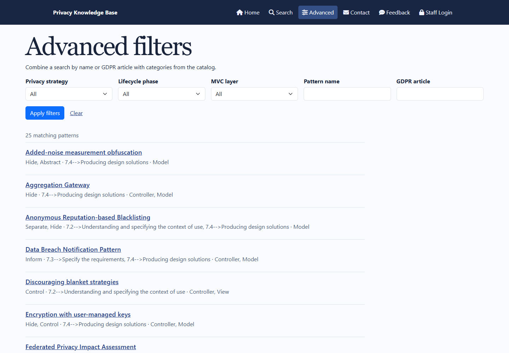

# Privacy Knowledge Base Platform

A catalog of 25 privacy design patterns. Readers can browse, search, and combine filters by strategy, lifecycle phase, MVC layer, and GDPR article. Staff accounts manage the catalog and review feedback according to their roles.



## Run locally

Use PHP with PDO MySQL and mbstring, and MariaDB 10.4 or later. Set the process variables listed in [.env.example](.env.example). The web process database user needs `SELECT, INSERT, UPDATE, DELETE` on its own database. Import the schema with a database initialization account.

```sh
mariadb --default-character-set=utf8mb4 -u root -p < database/setup.sql
php -S 127.0.0.1:8082 -t public
```

After exporting `DEMO_ACCOUNT_PASSWORD` for the CLI process, create demo accounts. Use a sample password of 12–72 bytes.

```sh
php bin/demo-account.php admin demo_admin
php bin/demo-account.php security-manager demo_reviewer
```

If upgrading a previous development database, apply the schema again to add review tracking, then run `php bin/demo-account.php --hash-existing` once with its database configuration. Existing entries are retained. Use `public/` as the web document root.

## Design and checks

The same repository query powers live search, form submission, and advanced filters. Search is usable without JavaScript. The Security Manager marks feedback reviewed while preserving the record. Staff authentication uses hashed passwords and session roles.

Run `php -l` on all PHP source. Check public search, a pattern detail page, administrator access, and the separate review role against the demo database.

Use the [GDPR text](https://eur-lex.europa.eu/eli/reg/2016/679/oj), [ISO/IEC 27701:2019 reference record](https://www.iso.org/standard/71670.html), [OWASP Top 10 (2021)](https://owasp.org/Top10/2021/), and [MITRE CWE](https://cwe.mitre.org/) to evaluate the academic mappings for your own use case. The catalog records educational relationships, with OWASP references tied to the 2021 edition where applicable.

## Italiano

Il catalogo conserva i 25 pattern del progetto universitario. La ricerca funziona anche senza JavaScript e i filtri provengono dal catalogo. L’amministratore gestisce i pattern, mentre il Security Manager registra la revisione dei feedback. Usa lo schema e la procedura di avvio indicati sopra per un ambiente dimostrativo separato.

## Academic context and attribution

Giovanni Rutigliano and Michele Magrone. **Ingegneria del Software**, Università degli Studi di Bari Aldo Moro, Department of Computer Science (ITPS), A.Y. 2023/2024. See the [academic documentation and manual](docs/academic_archive). The repository does not declare an open-source license.
